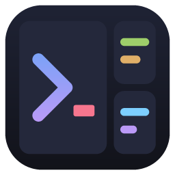
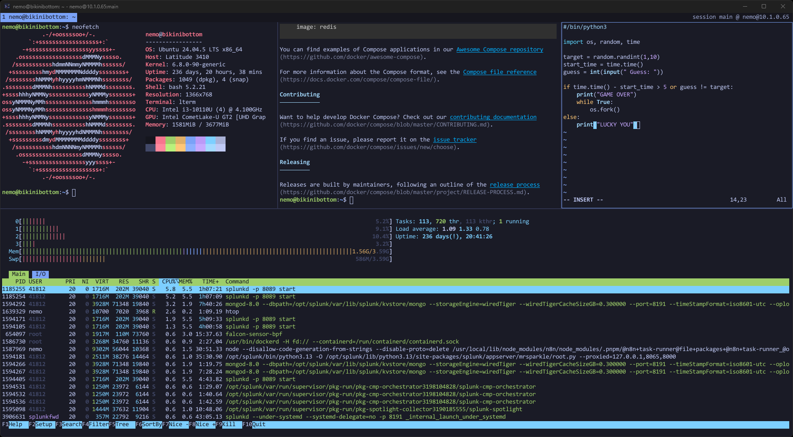
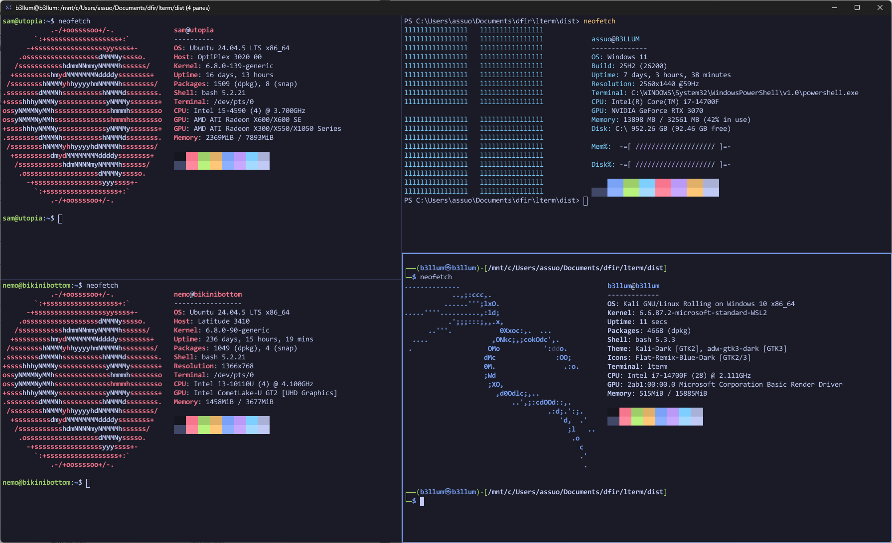
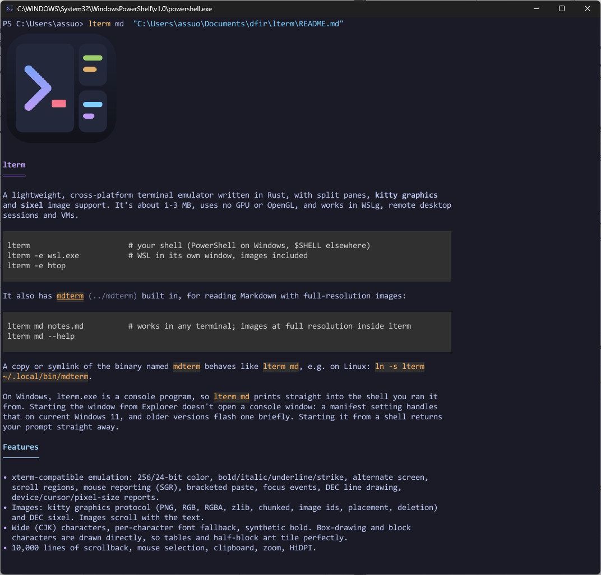
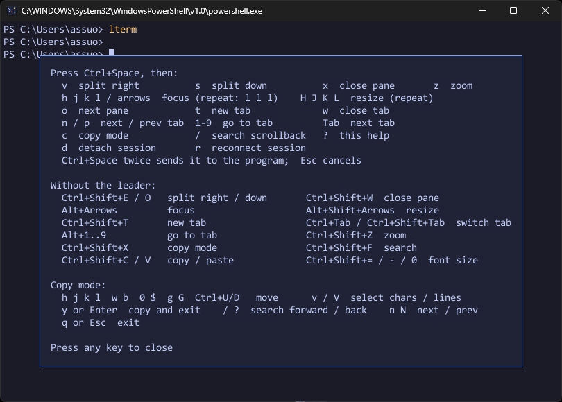
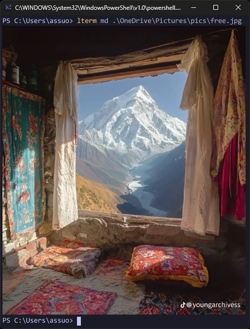
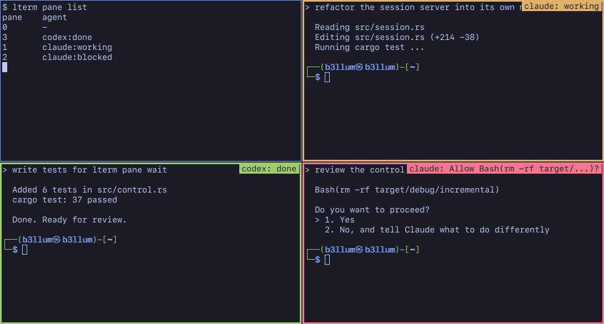

<p align="center"></p>


## Diagram 

[](https://gitdiagram.com/b-3llum/lterm?utm_source=readme&utm_medium=badge)

# lterm

A small, fast terminal for Windows and Linux with splits, tabs, tmux-style sessions, inline images,
and panes that show what your coding agents are doing.



| Splits across machines | Markdown with images |
|---|---|
|  |  |

| Help menu (Ctrl + space) | Image render |
|---|---|
|  |  |

## Install

Download from [Releases](https://github.com/b-3llum/lterm/releases/latest), then run:

```
lterm install            # adds lterm to your PATH and app menu (no admin needed)
```

On Windows, unzip `lterm-windows-x86_64.zip` and run `lterm.exe install` from that folder.
On Linux, run `chmod +x lterm-linux-x86_64 && ./lterm-linux-x86_64 install`.

## Use

```
lterm                          # open a terminal
lterm -e wsl.exe               # run something else instead of your shell (new panes run it too)
lterm md notes.md              # read Markdown with images
lterm keys                     # list every shortcut
```

### Work on a server

```
lterm push user@server         # 1. install lterm there (asks first, one password prompt)
lterm --attach user@server     # 2. connect. Split and add tabs freely, with no new logins
```

- **Detach:** press `Ctrl+Space d` or close the window. Everything keeps running.
- **Come back:** run the same `--attach` command. Your tabs, splits and scrollback are restored.
- **Connection dropped?** Press `Ctrl+Space r` to reconnect.
- **Several sessions:** add `-s NAME` (for example `-s logs`). On the server, `lterm ls` lists them and `lterm kill NAME` ends one.
- **On Windows,** `lterm --attach wsl` does the same with shells inside WSL.

### Run coding agents side by side



lterm shows what each coding agent is doing, so you can run several at once and see which one needs you:

| Pane | Means |
|---|---|
| Yellow border, `working` | The agent is generating or running tools. |
| Red border, with what it's asking | It's blocked on you: a permission prompt or a question. |
| Green border, `done` | It finished its turn. The border fades once you've looked at the pane. |

Tabs get a dot in the color of their most urgent agent, the tab bar counts agents by state, and the
window flashes in the taskbar when an agent finishes or gets blocked while you're elsewhere.

- **Agents sidebar:** `Ctrl+Space a` (or `Ctrl+Shift+A`, or start with `lterm --sidebar`) lists every agent
  in every tab with its state or question. Click one to go to it.
- **Next agent that needs you:** `Ctrl+Space u` jumps to a blocked agent first, then one that finished.
  Keep tapping `u` to go through them.

Turn it on once per agent (restart the agent afterwards):

```
lterm integration install claude   # Claude Code: hooks in ~/.claude/settings.json (backup kept),
                                   #   plus the lterm-panes skill (see below)
lterm integration install codex    # Codex: hooks in ~/.codex/hooks.json, notify in config.toml
lterm integration                  # show what's installed; `uninstall` removes it
```

Codex runs only hooks you've reviewed: after installing, start Codex, type `/hooks` and trust lterm's.

Any other tool can report its own state with `lterm pane state working|blocked|done|idle|none --agent NAME`.
Desktop notifications from programs (OSC 9, 777 and 99) also mark a pane as needing you.

### Let agents and scripts drive panes

Programs running inside lterm (coding agents such as Claude Code or Codex, scripts) can open
panes, type into them, read them and wait for them with `lterm pane`. A lead agent can start
helpers in splits and wait for them to finish:

```
id=$(lterm pane split --run "claude 'fix the failing auth tests'")   # new pane, prints its id
lterm pane wait $id --state done,blocked    # until it finishes or needs someone
lterm pane wait $id --idle 5          # or: until it has printed nothing for 5 s
lterm pane read $id --lines 40        # its last 40 lines of text
lterm pane send $id "also run the linter"     # type a line and press Enter
lterm pane keys $id esc               # or press keys: enter, up, ctrl-c, ...
lterm pane list                       # every pane: id, tab, size, focus, agent state, title
lterm pane close $id
```

With the integration installed, Claude Code also gets the `lterm-panes` skill, so you can simply ask it:
*"split this refactor across two helpers in panes and review their work"*. It writes each helper a task
file, starts them in splits, waits for them, and reads their results. It won't answer a helper's
permission prompts for you: it tells you which pane needs you.

It works in plain windows and in sessions (`--attach`), including while no window is attached;
agents keep reporting while you're detached and the window shows their state when you come back.
`lterm pane --help` lists every option.

## Shortcuts

Press **Ctrl+Space**, let go, then press a key. **F1** shows every shortcut in the window.

| After Ctrl+Space | Action | After Ctrl+Space | Action |
|---|---|---|---|
| `v` / `s` | split right / down | `t` | new tab |
| `h j k l` or arrows | move between panes | `n` / `p` | next / previous tab |
| `H J K L` | resize (tap again to repeat) | `1`–`9` | go to tab |
| `o` | next pane | `w` | close tab |
| `z` | zoom pane / restore | `c` | copy mode |
| `x` | close pane | `/` | search scrollback |
| `?` | help | `d` / `r` | detach / reconnect |
| `a` | agents sidebar | `u` | next agent that needs you |

**Without the leader:**

| Keys | Action |
|---|---|
| Ctrl+Shift+E / O | split right / down |
| Alt+Arrows / Alt+Shift+Arrows | move between / resize panes |
| Ctrl+Shift+T, Ctrl+Tab, Alt+1–9 | new tab, next tab, go to tab |
| Ctrl+Shift+W / Z | close / zoom pane |
| Ctrl+Shift+C / V | copy / paste (right-click also copies or pastes) |
| Ctrl+Shift+F | search scrollback |
| Ctrl+Shift+A | agents sidebar |
| Ctrl+Shift+= / - / 0 | font size bigger / smaller / reset |
| Shift+PageUp / PageDown | scroll history (or use the mouse wheel) |

**Copy mode** (`Ctrl+Space c`): move with `h j k l`, `w b`, `0 $` and `g G`. Press `v` (characters) or `V` (lines) to select, `y` to copy, `/` to search, `n` / `N` for the next / previous match, and `q` to quit.

**Mouse:** click a pane to focus it, drag to select, and Shift+drag to select inside programs like vim or htop.

**Different leader?** Use `lterm --leader ctrl+a` (or `alt+space`, `f12`), or set `LTERM_LEADER`.

## Notes

- **SSH:** password and host prompts appear in a small window, and nothing is saved.
  Use `LTERM_SSH="ssh -p 2222"` for custom ssh options.
- **Updating:** run `lterm install` again so the hooks find the new version, and `lterm push` to
  servers you attach to (a window and its session server must be the same version).
- **Agent state without hooks:** with only `notify` (older Codex, or hooks not trusted yet), Codex
  reports finished turns, so pressing Enter in its pane counts as `working`. Programs lterm knows
  nothing about show no state.
- **Windows images** need `conpty.dll` and `OpenConsole.exe` next to `lterm.exe`
  (included in the Windows zip, from Microsoft's MIT-licensed ConPTY package).
- **Linux build** needs glibc 2.39 or newer (Ubuntu 24.04+, Debian 13+). On older systems, build from source.
- **Build:** `cargo build --release`. For Windows from Linux, add `--target x86_64-pc-windows-gnu`.
